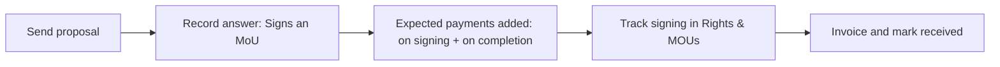
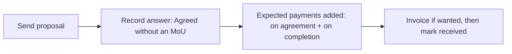
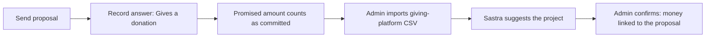

# UX Design Specification: Funding path (proposals, MoUs, and donations)

**Author:** Sastra team
**Date:** 2026-11-09

---

## Executive Summary

### Project Vision

A partner proposal does not always end in an MoU. Sastra should follow the money
the way the team does: **ask → answer → promise → received**. One proposal, one
recorded answer, and the next step is always clear.

### Target Users

- **Managers** who send proposals and follow up with partners. Many read English
  as a second language. They need short words and one obvious next step.
- **Admins** who import the giving-platform CSV from time to time and assign
  donations to projects.

### Key Design Challenges

1. **Everything after a proposal is called "MoU".** The payment list, its
   buttons, and its errors all say "MoU payment", even when no MoU exists. Usage
   shows payment schedules are common on projects without a signed MoU.
2. **The proposal is a dead end.** Its status is a small Sent / Accepted /
   Declined menu inside a collapsed history. Choosing Accepted changes nothing
   else.
3. **A donation never closes the loop.** Money that arrives through Donations
   becomes a receipt with a free-text donor. It is not connected to the proposal
   that asked for it, so the proposal stays "sent" forever.
4. **The story is split over three tabs.** Asked is in Partners & proposals,
   promised is in Payments, received is in Cash flow. Nobody sees one partner's
   whole path.

### Design Opportunities

- One small question — "What did the partner decide?" — can drive the right next
  step for each of the four real outcomes.
- The data already exists (proposals, scheduled payments, receipts, donation
  allocations). The redesign mostly **connects** records and **renames** one
  concept. No money math changes for existing records.

## Core User Experience

### Defining Experience

**Record the partner's answer.** After a proposal is sent, the manager records
one of four answers. Sastra then shows what to do next.

| Partner's answer | What it means | What Sastra does next |
| --- | --- | --- |
| **Signs an MoU** | A signed funding agreement with set payments. | Adds expected payments (first on signing, final on completion). Links to **Rights & MOUs** to track signing. |
| **Agreed without an MoU** | The partner agreed by email or in conversation. A set amount is expected; an invoice can be sent. | Adds expected payments (first on agreement). No MoU wording anywhere. |
| **Gives a donation** | No MoU and no invoice. Money arrives through the giving platform. | Counts the promised amount (if known) as committed. Waits for the next Donations import and links the money when it arrives. |
| **Declined** | No funding from this proposal. | Closes the proposal. The funding gap stays open. |

A gift for several books is handled by the same answers: record "Gives a
donation" on each project's proposal, and the Donations import suggests the
split. One agreement for several books stays a **Shared MoU**.

### Platform Strategy

Web app, desktop first for finance work, fully usable on a phone. No new routes:
the work stays on the project's **Budget** page and the admin **Donations** page.

### Effortless Interactions

- The answer dialog fills the agreed amount from the proposal total.
- "Two payments" is preselected, matching the team's usual schedule.
- When the CSV is imported, a donation from a partner with an open proposal is
  suggested for that project and linked to the proposal on confirmation.
- A receipt that arrived before the answer was recorded can be linked in one
  step from the answer dialog or from the receipt.

### Critical Success Moments

1. The manager records an answer and immediately sees the funding gap change.
2. An admin imports a CSV and the proposal row moves to **Received** without
   anyone editing the project.
3. A manager opens Budget and reads one row per proposal: asked, answer,
   promised, received, next step.

### Experience Principles

1. **Money words match reality.** Say "MoU" only when there is an MoU.
2. **Every proposal ends in an answer.** No silent, forever-"sent" proposals.
3. **One row tells the story.** Asked → answer → promised → received.
4. **Nothing moves money by itself.** Answers, links, and suggestions are
   reviewed by a person. Sending and posting keep their explicit confirmations.
5. **Old records stay true.** Existing payments and receipts are not rewritten.

## Desired Emotional Response

### Primary Emotional Goals

Calm and certain. A manager should feel "I know where every proposal stands",
not "I hope I remembered to update that".

### Emotional Journey Mapping

- **Sending:** confident — the proposal no longer assumes an MoU.
- **Waiting:** unworried — the row says how long it has been waiting, without
  alarm colors. A donation answer says the money will appear after the next
  import, because imports are occasional.
- **Answer arrives:** quick relief — one dialog, one save.
- **Money arrives:** trust — the row shows the received amount and where it came
  from.

### Micro-Emotions

Confidence over confusion (plain labels), trust over doubt (links back to the
real payment or donation record), accomplishment (a closed row).

### Design Implications

- Waiting is **info**, not warning. Only "partner agreed but no expected
  payments were added" is a warning, because the funding gap is then wrong.
- Donation promises never show "overdue".
- Declined rows are muted, not red.

### Emotional Design Principles

Quiet by default; state the next step in words; never punish an irregular
import rhythm.

## UX Pattern Analysis & Inspiration

### Inspiring Products Analysis

- **Sales pipelines (deal stages):** one object moves through named stages and
  the stage decides the next action. We borrow the single "outcome" decision,
  not the board.
- **Accounting receivables:** expected money and received money are separate
  lists that link to each other. Sastra already does this; we keep it.
- **Sastra's own Shared MoU page:** shows blockers in plain words ("4 of 5
  projects complete"). The funding path row uses the same voice.

### Transferable UX Patterns

Outcome dialog with radio cards; a compact status row with one primary action;
evidence-based suggestions that a person confirms (already used in Donations).

### Anti-Patterns to Avoid

- A status menu that changes a label and nothing else.
- Naming a list after one legal document type.
- Auto-posting money or auto-changing an answer.
- A separate CRM screen that duplicates the project Budget.

### Design Inspiration Strategy

Adopt the outcome decision. Adapt receivables wording to "expected payments".
Avoid a new pipeline screen for now: the Budget attention summary already
surfaces what needs action.

## Design System Foundation

### 1.1 Design System Choice

The existing Sastra system: shadcn-style components (`Card`, `Dialog`, `Badge`,
`Button`, `Input`, `Label`), Tailwind v4 tokens, `HelpTip` for one-sentence
explanations.

### Rationale for Selection

This is a refinement inside an established screen. New visual language would
add learning cost for no benefit.

### Implementation Approach

One new client component (`FundingPathPanel`) with an answer dialog. Existing
components change copy and gain small badges.

### Customization Strategy

None. Use existing semantic tokens (`info`, `warning`, `success`, `muted`).

## 2. Core User Experience

### 2.1 Defining Experience

"Record answer" on a proposal row.

### 2.2 User Mental Model

The team thinks in partners and promises: "We asked Partner X for $12,000. They
said yes, no MoU. Half came in." Today the app thinks in documents and tabs.
The funding path row matches the team's sentence, left to right.

### 2.3 Success Criteria

- A manager can record any of the four answers in under 30 seconds.
- After saving, the Budget summary, the attention list, and the proposal row
  agree with each other.
- A donation imported later is linked to the right proposal with one confirm.
- No screen says "MoU payment" for money that has no MoU.

### 2.4 Novel UX Patterns

None. Radio-card dialog, status row, and reviewed suggestions are all familiar.

### 2.5 Experience Mechanics

1. **Initiation.** In **Budget → Partners & proposals**, the **Proposals and
   answers** card lists each sent proposal. A waiting row shows **Record
   answer**.
2. **Interaction.** The dialog asks "What did the partner decide?" with four
   choices. Each choice reveals only its own fields:
   - *MoU / Agreed without MoU:* agreed amount; expected payments (two
     payments, one payment, or add later).
   - *Donation:* amount if known; tick any received money already on the
     project that belongs to this proposal.
   - *Declined:* nothing more.
   - All: date of the answer and an optional note.
3. **Feedback.** The row updates at once. If saving fails, the row returns to
   its previous state and the dialog reopens with the entered values.
4. **Completion.** The row shows the answer badge, promised and received
   amounts, and the next step (for example **Add expected payments**, **Open
   payments**, or "Waiting for the next donation import").

## Visual Design Foundation

### Color System

Existing tokens. Answer badges: waiting = secondary; MoU, agreed, donation =
default; declined = outline. Warning color only for "agreed, no expected
payments".

### Typography System

Existing. Amounts use tabular numbers.

### Spacing & Layout Foundation

The funding path card uses the full tab width. Rows are a responsive grid inside
a named container (`@container/funding`): one stacked block per proposal when
narrow, a five-column row when wide.

### Accessibility Considerations

Radio cards are real radio inputs with visible labels. Badges always carry
text. The dialog traps focus and restores it to the row's button.

## Design Direction Decision

### Design Directions Explored

1. **Rename only.** Change "MoU payment" to neutral words. Cheap, but the
   proposal stays a dead end.
2. **Answer-led funding path (chosen).** Rename, add the answer step, connect
   payments and receipts to the proposal, show one row per proposal.
3. **Separate partner pipeline screen.** A cross-project board of proposals.
   Powerful, but a new place to learn before the per-project path is proven.

### Chosen Direction

Direction 2.

### Design Rationale

It fixes the dead end and the wrong words together, uses existing records, and
keeps the manager on the screen they already use.

### Implementation Approach

Additive database columns only (all optional). Existing rows keep working with
neutral labels.

## User Journey Flows

### Proposal becomes an MoU

### Partner agrees without an MoU

### Partner just gives a donation

If the money arrives before anyone records an answer, the import still suggests
the project (the proposal is waiting and the donor matches). The row then shows
the received amount and asks the manager to record the answer.

### One gift for several books

Each project's proposal gets "Gives a donation". On import, when the promised
amounts add up to the donation, Sastra suggests the split. Otherwise it lists
the candidate projects and the admin enters the split.

### Journey Patterns

Every journey is the same three beats: answer → promise → received.

### Flow Optimization Principles

Defaults match the common case; nothing is created that the user did not see in
the dialog; each row always names one next step.

## Component Strategy

### Design System Components

`Card`, `Dialog`, `Badge`, `Button`, `Input`, `Label`, `Textarea`, `HelpTip`.

### Custom Components

#### FundingPathPanel

- **Purpose:** one row per sent proposal — partner, asked, answer, promised,
  received, next step.
- **States:** waiting, MoU, agreed without MoU, donation, declined; each with
  "no money yet", "part received", "all received".
- **Actions:** Record answer / Change answer; Link received money; jump to
  Payments, Rights & MOUs, or Cash flow.
- **Empty state:** "No proposals sent yet. Send a proposal below, then record
  the partner's answer here."

#### ProposalAnswerDialog

Radio-card choice plus the fields in section 2.5. Primary button: **Save
answer**.

#### Changes to existing components

- **Expected payments** (was "MoU Payment Schedule"): neutral title and
  buttons; each payment shows **MoU** or **No MoU** when known, and the partner
  name. The first-payment trigger reads "On signing" for an MoU and "On
  agreement" without one.
- **Funding received:** a receipt can be linked to a proposal; linked receipts
  show which proposal they answer.
- **Proposal history:** shows the answer as a badge. The old status menu is
  removed; answers are recorded in one place.
- **Budget attention:** adds "Proposals waiting for an answer" (info) and
  "Partner agreed — add expected payments" (warning).
- **Donations review:** a new suggestion source — open proposals to the donor.

### Component Implementation Strategy

Pure logic (labels, totals, next step) lives in `lib/budget/funding-path.ts`
with unit tests. Components render that result.

### Implementation Roadmap

1. Data: optional columns on proposals, expected payments, and receipts.
2. Logic and server actions (answer, link).
3. Budget UI: funding path card, dialog, renamed payments, receipt link.
4. Donations: suggestion and link on confirmation.
5. Copy: proposal email, help docs, terminology.

## UX Consistency Patterns

### Button Hierarchy

One primary action per row (**Record answer**). Secondary actions are outline
or text links. Buttons are verb + object.

### Feedback Patterns

- Answer and link changes are optimistic with exact rollback and an error
  toast that says what to do next.
- Creating expected payments happens with the answer in one save; they appear
  after the server confirms.

### Form Patterns

Only the fields for the chosen answer are shown. Amounts are optional where
the real world is uncertain (a donation of unknown size).

### Navigation Patterns

Row links jump to the existing tabs by their bookmarks. No new routes.

### Terminology

| Concept | Use | Avoid |
| --- | --- | --- |
| What the partner decided about a proposal | **partner's answer** | status, outcome, response |
| Money a partner promised for a set amount, with or without an MoU | **expected payment** | MoU payment, receivable, installment (as the list name) |
| A partner's promise to give without an MoU or invoice | **donation** (answer: "Gives a donation") | gift, pledge |

## Responsive Design & Accessibility

### Responsive Strategy

Rows stack on narrow containers and align in columns on wide ones, by container
width (not viewport), because the sidebar changes the available space. The
dialog scrolls inside 90dvh on phones.

### Breakpoint Strategy

App navigation breakpoints are unchanged. The card uses a named container
query for its row layout.

### Accessibility Strategy

WCAG AA contrast with existing tokens; keyboard reachable radio group; text
labels on every badge; touch targets at least 40px on phones.

### Testing Strategy

- Unit tests for funding-path logic, donation suggestions, and the answer
  action (permission, payment creation, rollback on invalid input).
- Browser review of Budget in light and dark themes at 1440 and 390 wide.

### Implementation Guidelines

Follow `docs/copy-style-guide.md` for every new string. Keep
`content/help/budget.md` and `content/help/donations.md` in step with the
screens.

## Out of Scope (possible next steps)

- A cross-project list of proposals waiting for an answer.
- Sending one proposal that covers several projects.
- Editing historical payments to set MoU / No MoU in bulk.
