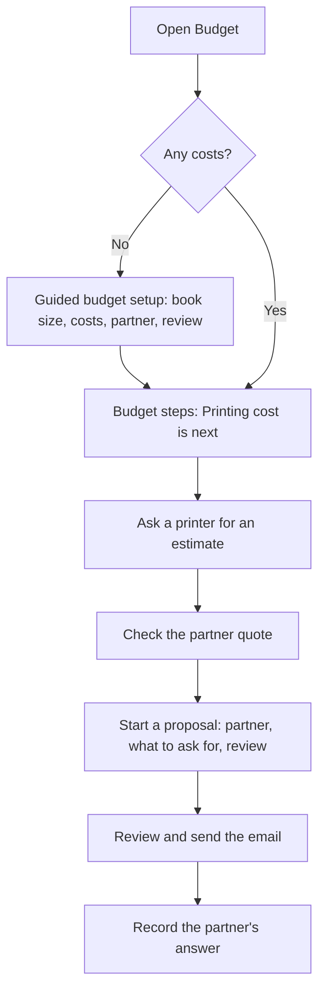
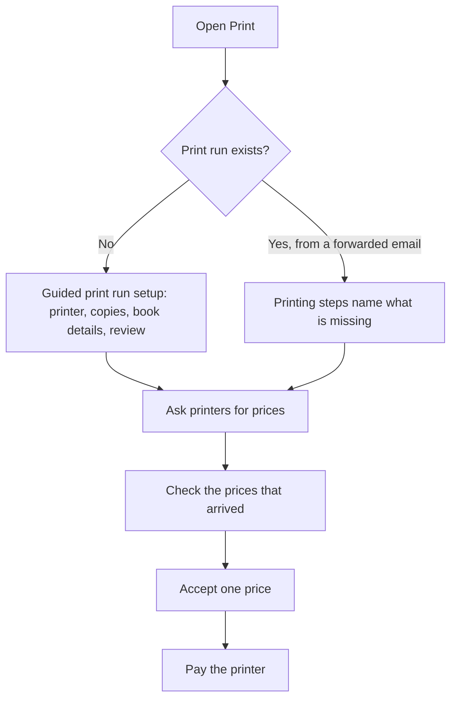

# UX Design Specification: Guided setup (budget, proposal, print run)

**Author:** Sastra team
**Date:** 2026-11-10

---

## Executive Summary

### Project Vision

Creating a budget, sending a partner proposal, and setting up a print run should
not depend on knowing where things are. Sastra already holds most of the answers
(book size, rates, partners, printers, earlier specs). It should **bring them to
the person**, ask only for what is missing, and always show the one next step.

### Target Users

- **Managers** who have not done budget or print work before. Many read English
  as a second language and have mixed software experience.
- **The one experienced person** who does this work today. Guidance must not slow
  them down: every guided setup can be skipped, and the full editors stay.

### What current usage shows

Aggregate, read-only checks of production (counts only, no names or amounts):

| Finding | What it means for the design |
| --- | --- |
| One person does almost all budget and print work. A second person does a little. Seven others do none. | The flows are learnable only by doing them often. Guidance has to carry a first-time manager from start to finish. |
| About three in four budgets have cost lines but **no word count or source pages**. Only about one line in five uses an automatic quantity. | People type amounts by hand because the book size lives in a separate settings card. Ask for book size **first**, in the same flow as the costs. |
| About one budget in four has standard lines that still cost **0**. | "Add standard budget items" adds every line, including ones the project does not need. Let people **choose** the costs. |
| Half of the budgets with a funding partner have **no partner email**. The partner directory is small and only some partners have a contact email. | The proposal stops at the send step and sends the person back to Quotation. Ask for the email where the partner is chosen. |
| Many budgets exist, a few have asked for approval, and very few proposals were sent from Sastra. No project uses partner quotations yet. | The path from costs to a sent proposal is not visible. The primary proposal tool is a blank dialog with every field optional. |
| There is one printer contact, and few projects have a default printer. | Never make people choose from a list of one. Preselect it. |
| About half of first print runs were created by Sastra from a forwarded email, with missing copies and specs. | The guide must work for runs it did not create, and name what is missing. |
| Most printer prices are still **waiting for review**, and half of the runs have no accepted price. | The slow step in printing is not setup. It is seeing that prices arrived and reviewing them. The guide must point there. |
| Many book budgets have no print run and no printing cost. | Printing is a step people do not know to start from Budget. |
| Nobody turned guidance off. Almost nobody dismissed the "Show steps" tips. | Guidance is welcome. The static text is simply not doing enough. |

### Key Design Challenges

1. **The help is a paragraph, not the page.** "Budget in four steps" and
   "Printing in five steps" are fixed text behind **Show steps**. They cannot
   say which step this project is on or what is missing.
2. **Known facts are spread over tabs.** Book size is on Overview, Budget
   settings, and Print defaults. The partner is in Quotation settings, the
   Partners directory, and the agreement. The printer is in Print defaults.
3. **Creation forms start empty.** The print run form has three fields and no
   specs. The partner quotation dialog has no defaults. The empty budget offers
   one button that adds everything.
4. **The next step is on another tab.** After costs come the partner quote, then
   approval, then the proposal, then the answer. Each is somewhere else.

### Design Opportunities

- A **live step list** computed from the project's own records can replace the
  static tips with no new data.
- Three **guided setups** can reuse the existing actions and editors. They add
  order, defaults, and plain words; they do not add a second way to store data.

## Core User Experience

### Defining Experience

> "Sastra tells me where I am, shows what it already knows, and asks me one
> small thing at a time."

Two parts work together:

1. **Steps** (always there): a short list at the top of Budget and Print. Each
   step is done, next, or later. The next step states the fact that matters and
   has one button that goes to the exact place.
2. **Guided setup** (at the moment of creation): three to four screens that
   collect what is needed, already filled in where Sastra knows the answer.

### Platform Strategy

Web app, used on laptops and phones. Guided budget and print run setup are
**inline on the page**, never an overlay tour. Guided proposal setup stays in
the dialog that partner quotations already use, with its buttons pinned to the
bottom. All three use the existing `GuidedSteps` controller, so they have
visible progress, Back without losing input, and an always-visible way out.

### Effortless Interactions

- A value Sastra knows is **already in the field**, with a short line that says
  where it came from ("From book details", "Used on the last print run").
- A list with one choice is **already chosen**.
- A missing value that blocks a later step is asked for **now**, with the reason
  ("You need an email to send the proposal").
- Skipping is always allowed. A skipped value shows up later as the next step.

### Critical Success Moments

- A manager opens an empty Budget and has a costed quotation in under two
  minutes, without opening Settings.
- A manager starts a proposal and reaches the email draft without leaving
  **Partners & proposals**.
- A manager creates a print run that already has trim size, pages, paper, and
  copy amounts, and sees **Ask for prices** as the next step.
- A manager opens Print and sees "4 prices are waiting for your review" first.

### Experience Principles

1. **Known first.** Prefill, then ask. Say where a prefilled value came from.
2. **One next step.** One primary button per step. The rest is quiet.
3. **Nothing hidden, nothing forced.** Every guided setup can be skipped. The
   full editors stay available and unchanged.
4. **True state only.** Steps come from saved records, so they are right for
   imported, forwarded, and older projects too.
5. **Nothing is sent by a guide.** Emails keep their review and confirm steps.

## Desired Emotional Response

- **Before:** "Where do I start?" → **After:** "I can see the next step."
- Calm and confident, not rushed. No red until something is actually wrong.
- Finishing a guided setup should feel like progress: the step list shows the
  finished step checked, and the next one is ready.
- Experienced users should feel **no friction**: the step list is one compact
  line when collapsed, and it can be hidden.

## UX Pattern Analysis & Inspiration

- **Setup checklists** in accounting and payments tools: progress derived from
  real data, one call to action per step. Transfer: the step list.
- **Tax-form style interviews**: one topic per screen, a running total, and a
  review screen before anything is saved. Transfer: guided setup screens.
- **Anti-patterns to avoid:** overlay tours that block the page; wizards that
  hide the normal editor; "Next" on the last step; steps that cannot be left;
  a second copy of the data that drifts from the real records.

## Design System Foundation

No new visual language. Reuse `GuidedSteps`, `Stepper`, `Card`, `Badge`,
`Button`, `Input`, `HelpTip`, and the existing tokens. One new presentational
component (the step list) and one small shared one (a prefilled-value note).

## 2. Core Experience Detail

### 2.1 Steps (live step list)

Placement: under the Budget heading (main scope, people who can edit) and at the
top of Print. It replaces the static **Show steps** tip and keeps the same
guidance keys, so a person who hid the old tip keeps it hidden.

Anatomy:

- Title: "Budget steps" / "Printing steps", with "3 of 6 done".
- The **next** step is open: name, one fact, one button, and (optional) a quiet
  second link.
- Other steps are one line each: a check for done, a number for later. Done
  steps keep a short fact ("7 costs · $12,400") and a link to change them.
- **Hide steps** collapses the list for this person. **Show steps** next to the
  heading brings it back. Guidance turned off in Profile hides it.
- When every step is done, the list is one line: "All budget steps are done."

Budget steps (main project scope):

| Step | Done when | Fact when not done | Button |
| --- | --- | --- | --- |
| Book size | word count or source pages is saved (shown once costs exist and a cost is calculated from words or pages; guided setup asks for it on an empty budget) | "Word and page costs cannot be calculated until you enter the book size." | Enter book size |
| Costs | at least one cost besides printing, and none of them is 0 | "No costs yet." / "3 costs have no amount yet." | Start guided setup / Review costs |
| Printing cost (required for books, optional for other kinds, absent for podcasts and video) | a Print / ship cost above 0 exists. A printing cost of 0 that waits for a printer is never called a missing amount. | "No printing cost yet. Ask a printer for an estimate." / "Waiting for a printer’s price." | Ask for an estimate / Open Print |
| Partner quote | a partner quote is saved and covers the costs after the organization fee | "The partner quote is $X less than the costs need." | Check the partner quote |
| Proposal | a proposal was sent (internal approval is named here when it is required) | "No proposal yet." / "Waiting for approval." / "Ready to send." | Start a proposal / Open approvals |
| Answer and money | every sent proposal has an answer, and agreed amounts have expected payments | "1 proposal is waiting for an answer (12 days)." | Record answer |

Printing steps (current print run; same five steps as the help page):

| Step | Done when | Fact when not done | Button |
| --- | --- | --- | --- |
| Set up a print run | a run exists with a printer and copy amounts | "No print run yet." / "Missing: printer." | Start guided setup / Add the printer |
| Ask printers for prices | a request was sent or a price exists | "No request sent yet." | Write the request |
| Check the prices | a price is accepted, or no price is waiting for review (other copy amounts of an accepted quote do not ask for review) | "4 prices are waiting for your review." | Review prices |
| Accept one price | one price is accepted | "Compare the prices and accept one." | Compare prices |
| Pay the printer | every print payment is paid | "Deposit is not paid yet." | Open payments |

### 2.2 Guided budget setup

Shown instead of the empty **No quotation yet** card (the old **Add standard
budget items** button stays as "Skip guided setup").

1. **Book size.** Word count and source pages, prefilled when saved. A live line
   shows the estimated printed pages. "I do not know yet" is allowed; word and
   page costs then wait and the step list keeps the step open.
2. **Costs.** A checklist of the standard costs at this project's rates.
   Publishing costs are on, audio and video are off. Each row shows quantity ×
   rate = amount, live. Rates and quantities can be changed. Custom costs can be
   added. A running total stays visible. Printing is not typed here: a note
   explains that it comes from a printer estimate (the next step).
3. **Funding partner.** Choose a saved partner and contact, or type a new one.
   Prefilled from the agreement when one names the funder. The email is marked
   "needed to send a proposal". "Decide later" is allowed.
4. **Review.** Costs total and the amount needed from partners after the
   organization fee. Button: **Create budget**. Nothing is emailed. Setup does
   not change partner prices; the **Partner quote** step shows the shortfall and
   links to the existing **Apply fee coverage** control.

The result is exactly what the existing editors would have stored: budget lines,
budget settings, and the funding partner. Saving is one request; a retry does
not create duplicates.

### 2.3 Guided proposal setup

**Start a proposal** in Partners & proposals replaces the blank dialog for new
partner quotations (editing an existing one keeps the full form).

1. **Partner.** Saved partner or new. Prefilled with the project's funding
   partner. Contact name and email; the email is required to send, not to save.
2. **What to ask for.** Default: **everything that still needs funding**, with
   the total. Or **Choose costs** to pick lines and amounts (the existing
   share controls). The title is filled in for the person ("Full project" or the
   chosen costs) and can be changed.
3. **Review.** Partner, total, and what happens next (approval if the workspace
   requires it, then the email). Button: **Save and write the email**. It saves
   the partner quotation and opens the existing proposal draft for review.
   Sending still needs the person's review and confirmation.

### 2.4 Guided print run setup

Replaces the three-field **Set up print run** form (Skip shows the old form).

1. **Printer.** The default or only printer is chosen. A new printer can be
   added here (name, company, email).
2. **Copies.** How many copies to print (optional), and the copy amounts to ask
   prices for, as editable chips starting from the last run or 1,000 / 2,000 /
   3,000.
3. **Book details.** Trim size from Print defaults; printed pages from the page
   estimate; paper, cover, and binding copied from the last run or from another
   book (**Same specs as…**). Delivery place from workspace defaults. All
   editable, all optional.
4. **Review.** A summary of the request and the run’s name. Button: **Create
   print run**, with **Write the price request email next** ticked by default.
   Neither sends an email.

### 2.5 Success Criteria

- Zero-amount standard lines stop appearing in new budgets.
- New budgets save a word count or source pages in the same flow.
- New print runs have copies, pages, and paper filled at creation.
- People other than the one experienced person complete these flows.

## Visual Design Foundation

- Step list: one `Card`, compact rows, check / number markers that match the
  `Stepper`. The next step has a tinted background (`bg-primary/5`) and the only
  filled button.
- Prefilled note: `text-xs text-muted-foreground`, placed under the field.
- Money and counts use `tabular-nums`. No color is the only signal: every state
  has text ("Done", "Next", "Later").
- Touch targets at least 44px. Dark mode uses the same tokens.

## Design Direction Decision

Explored:

- **A. Full-page wizards** (like New project). Clear, but they take people away
  from the editor and the totals they are learning to read.
- **B. Overlay tours** that point at controls. Rejected: hostile to
  low-confidence users, fragile, and already ruled out in the guidance system.
- **C. Live step list + inline guided setup (chosen).** Guidance sits where the
  work is, state comes from records, and the editors stay the single source.

## User Journey Flows

## Component Strategy

| Component | Kind | Notes |
| --- | --- | --- |
| `lib/guidance/steps.ts` | pure | Step model, status rules, progress. |
| `lib/budget/steps.ts`, `lib/print/steps.ts` | pure | Build the two step lists from page data. Unit tested. |
| `components/guidance/step-list.tsx` | client | Renders a step list; hide / show per person. |
| `lib/budget/setup.ts` + `setup-actions.ts` | pure + server | Plan and save a guided budget. Manager only, idempotent. |
| `components/budget/budget-setup-guide.tsx` | client | Guided budget setup. |
| `components/budget/partner-quotations-panel.tsx` | changed | New quotations use guided steps with defaults. |
| `components/print/print-run-guide.tsx` | client | Guided print run setup; uses `createPrintRun`. |

## UX Consistency Patterns

- **Buttons:** verb + object. The last step never says "Next" or "Finish".
- **Feedback:** guided budget and print run creation show a pending label and
  keep every typed value if saving fails. Partner quotation saves stay
  optimistic with rollback, as today.
- **Skip:** always a quiet link, bottom left: "Skip guided setup".
- **Words:** "guided setup", "steps", "printer", "price" (for a printer quote
  amount in guidance text), "partner", "costs". See `docs/terminology.md`.

## Responsive Design & Accessibility

- Guided setup uses the existing `Stepper`: numbered steps on wide screens,
  "Step 2 of 4" with a bar on phones. Forms stay within a readable width.
- The step list is a real list (`ol`); the next step is marked with
  `aria-current="step"`. Hide / Show are buttons with clear names.
- Every field has a visible label. Errors say what to do next.
- Reduced motion: no added animation.

## Out of scope (not built)

- A guided flow for agreements / rights, donations import, or reprint budgets.
- A step list on Home across all projects.
- Changing how the partner quote, approvals, or email sending work.
